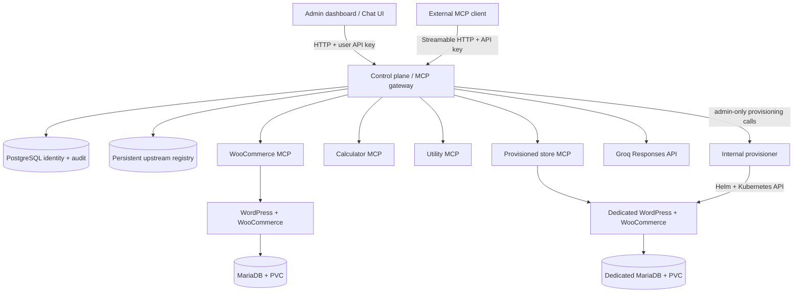

# Urumi — Team MCP Gateway

A Kubernetes-native MCP gateway for connecting tools from multiple upstream servers behind one authenticated endpoint. Urumi includes a WooCommerce operations server, Calculator and Utility MCP servers, an admin dashboard, an LLM-powered chat agent, persistent identity/API-key management, audit logging, and isolated on-demand WooCommerce store provisioning.

## Table of Contents

- [Features](#features)
- [Architecture](#architecture)
- [Repository Layout](#repository-layout)
- [Prerequisites](#prerequisites)
- [Quick Start Guide](#quick-start-guide)
  - [First-Time Setup](#first-time-setup)
  - [Running the Project](#running-the-project)
  - [Accessing the Application](#accessing-the-application)
  - [Login Instructions](#login-instructions)
- [Build and Regression Tests](#build-and-regression-tests)
- [Local Kubernetes Deployment](#local-kubernetes-deployment)
  - [Required Platform Secrets](#required-platform-secrets)
  - [Build Images for Minikube](#build-images-for-minikube)
  - [Install and Access](#install-and-access)
- [VPS/Production Deployment](#vpsproduction-deployment)
- [User Stories and Testing](#user-stories-and-testing)
  - [Store Operations](#store-operations)
  - [Chat Agent Usage](#chat-agent-usage)
  - [External MCP Client](#external-mcp-client)
  - [Team Control and Auditing](#team-control-and-auditing)
- [Upstream Authentication](#upstream-authentication)
- [Store Provisioning and Deletion](#store-provisioning-and-deletion)
- [Security and Operational Limitations](#security-and-operational-limitations)
- [Project Documentation](#project-documentation)

## Features

- **MCP aggregation:** combines enabled upstream tools at one Streamable HTTP MCP endpoint and exposes collision-safe names such as `woocommerce__list_products`, `calculator__mean`, and `store-store-two__list_products`.
- **WooCommerce operations:** `list_products`, `create_product`, `list_orders`, `get_order`, and `update_order_status`.
- **Additional upstreams:** Calculator (`calculate`, `mean`) and Utility (`get_current_time`, `generate_uuid`).
- **Access control:** admin/member roles, generated user API keys, hashed key storage, key revocation, and protected admin endpoints.
- **Auditing:** persistent PostgreSQL events record the authenticated identity, upstream/tool, start/completion, duration, and outcome.
- **Chat agent:** calls an LLM Responses API, discovers tools through the gateway, executes them through the same authenticated MCP endpoint, and displays its tool calls.
- **Multi-store provisioning:** creates a dedicated namespace, per-store WordPress/MariaDB deployment, credentials, PVCs, ingress, network-policy baseline, quotas/LimitRange, and WooCommerce MCP upstream; deletion removes the store namespace and release.
- **Kubernetes deployment:** separate reusable Helm charts for the shared platform and each WooCommerce store.

## Architecture



### Request path

1. A caller connects to the gateway's MCP endpoint and authenticates with a user API key.
2. The gateway filters and aggregates tools from enabled upstreams. An upstream's tools use the `<upstream-id>__<tool-name>` prefix.
3. The gateway routes tool calls to the selected upstream with a timeout and upstream-failure isolation.
4. The gateway writes an audit record for the authenticated call.
5. The chat agent uses the same gateway and identity path; the LLM provider key stays in a Kubernetes Secret and is never sent to the browser.

## Repository layout

```text
apps/dashboard/                    Admin dashboard and chat pages
charts/platform/                   Gateway, PostgreSQL, MCP upstreams, provisioner
charts/store/                      Reusable isolated WooCommerce store chart
images/wordpress-woocommerce/      WordPress/WooCommerce image customization
services/control-plane/            MCP gateway, API, auth, audit, chat orchestration
services/woocommerce-mcp/          WooCommerce MCP tools and signed REST client
services/calculator-mcp/            Calculator MCP tools
services/utility-mcp/               Utility MCP tools
services/provisioner/              Store lifecycle service
packages/shared/                    Shared package space

docs/                               Architecture, operations, and demo instructions
```

## Prerequisites

For the local demonstration:

- Node.js 24 and npm.
- Docker Desktop using Linux containers.
- Minikube, `kubectl`, and Helm.
- An ingress controller (the walkthrough uses the Minikube `ingress` add-on).
- A Groq API key for the chat agent.

The platform chart uses `admissionregistration.k8s.io/v1` `ValidatingAdmissionPolicy` resources, so the cluster must support Kubernetes **1.30 or newer**. Check your Minikube/k3s version before installing the chart.

## Quick Start Guide

### First-Time Setup

Follow these steps to set up the project from scratch:

1. **Clone the repository:**
   ```powershell
   git clone <repository-url>
   cd Team-MCP-Gateway
   ```

2. **Install dependencies and build:**
   ```powershell
   npm ci
   npm run build
   npm test
   npm run check
   ```

3. **Start Minikube with ingress:**
   ```powershell
   minikube start -p urumi-local
   minikube addons enable ingress -p urumi-local
   ```

4. **Create Kubernetes Secrets:**
   
   Create the required secrets in the `urumi-platform` namespace:
   
   ```powershell
   kubectl create namespace urumi-platform
   
   # Database credentials
   kubectl create secret generic urumi-gateway-db -n urumi-platform \
     --from-literal=postgres-db=urumi \
     --from-literal=postgres-user=urumi \
     --from-literal=postgres-password=<your-password> \
     --from-literal=database-url="postgresql://urumi:<your-password>@urumi-platform-postgres.urumi-platform.svc.cluster.local:5432/urumi"
   
   # Admin token
   kubectl create secret generic urumi-gateway-admin -n urumi-platform \
     --from-literal=admin-token=<your-admin-token>
   
   # LLM credentials (Groq API key)
   kubectl create secret generic urumi-llm-credentials -n urumi-platform \
     --from-literal=api-key=<your-groq-api-key>
   ```

5. **Build and load Docker images:**
   ```powershell
   docker build -f services/provisioner/Dockerfile -t urumi/provisioner:0.1.2 .
   minikube image load urumi/control-plane:0.1.11 -p urumi-local
   minikube image load urumi/provisioner:0.1.2 -p urumi-local
   minikube image load urumi/calculator-mcp:0.1.0 -p urumi-local
   minikube image load urumi/utility-mcp:0.1.0 -p urumi-local
   minikube image load urumi/woocommerce-mcp:0.1.7 -p urumi-local
   minikube image load urumi/wordpress-woocommerce:0.1.0 -p urumi-local
   ```

6. **Install the platform chart:**
   ```powershell
   helm install urumi-platform ./charts/platform \
     --namespace urumi-platform \
     --values ./charts/platform/values-local.yaml \
     --wait --timeout 10m
   ```

7. **Install the store chart:**
   ```powershell
   kubectl create namespace urumi-store
   
   kubectl create secret generic store-credentials -n urumi-store \
     --from-literal=db-root-password=<root-password> \
     --from-literal=db-password=<db-password> \
     --from-literal=wordpress-admin-password=<admin-password>
   
   kubectl create secret generic woocommerce-api-credentials -n urumi-store \
     --from-literal=consumer-key=<wc-consumer-key> \
     --from-literal=consumer-secret=<wc-consumer-secret>
   
   helm install urumi-store ./charts/store \
     --namespace urumi-store \
     --values ./charts/store/values-local.yaml \
     --wait --timeout 10m
   ```

8. **Add local DNS entries:**
   
   Edit `C:\Windows\System32\drivers\etc\hosts` and add:
   ```
   127.0.0.1 shop.urumi.test
   ```

### Running the Project

After initial setup, to run the project:

1. **Start Minikube (if not running):**
   ```powershell
   minikube start -p urumi-local
   minikube addons enable ingress -p urumi-local
   ```

2. **Port-forward services (3 separate terminals):**
   
   **Terminal 1 - Gateway:**
   ```powershell
   kubectl port-forward -n urumi-platform svc/urumi-platform-gateway 4016:4000
   ```
   
   **Terminal 2 - Ingress:**
   ```powershell
   kubectl port-forward -n ingress-nginx svc/ingress-nginx-controller 8080:80
   ```
   
   **Terminal 3 - React dev server:**
   ```powershell
   cd apps/dashboard
   npm run dev
   ```

3. **Verify services are running:**
   ```powershell
   kubectl get pods -n urumi-platform
   kubectl get pods -n urumi-store
   ```

### Accessing the Application

Once all services are running:

- **Admin Dashboard:** http://localhost:5173/dashboard/
- **Chat Agent:** http://localhost:5173/chat/
- **Storefront:** http://shop.urumi.test:8080/
- **WooCommerce Admin:** http://shop.urumi.test:8080/wp-admin/

### Login Instructions

#### Admin Dashboard Login

1. **Get your admin API key:**
   - If you don't have one, you can use the bootstrap admin token from the secret
   - Or create a new admin user in the dashboard (requires initial admin access)
   
2. **Login to dashboard:**
   - Navigate to http://localhost:5173/dashboard/
   - Paste your admin API key
   - Click "Connect to console →"
   - You now have full admin access to manage upstreams, users, and audit logs

#### Chat Agent Login

1. **Get your member API key:**
   - Login to the admin dashboard as an admin
   - Navigate to "Users & keys"
   - If no member exists, click "+ Create user"
   - Enter details (email, display name, role: "member")
   - Click "Create user"
   - **Copy the API key immediately** - it will not be shown again

2. **Login to chat:**
   - Navigate to http://localhost:5173/chat/
   - Paste your member API key
   - Click "Connect to chat →"
   - You can now ask questions that will be answered using MCP tools

3. **Switching between chat and dashboard:**
   - From chat, click "Admin console ↗" to go to dashboard
   - If you're a member, you'll be logged out and prompted to login with admin key
   - From dashboard, click "Chat agent ↗" to go to chat
   - Your session is maintained within each interface

#### Copying API Keys (Windows PowerShell)

**Option 1: From local files (if saved during setup):**

```powershell
# Admin API key
Get-Content "$env:USERPROFILE\.urumi-secrets\dashboard-admin-api-key.txt" -Raw |
    Set-Clipboard

# Member API key
Get-Content "$HOME\.urumi-secrets\demo-member-api-key-2.txt" -Raw |
    ForEach-Object { Set-Clipboard -Value $_.Trim() }
Write-Host "Member API key copied to clipboard."
```

**Option 2: From Kubernetes secret (admin only):**

```powershell
kubectl get secret -n urumi-platform urumi-gateway-admin -o jsonpath='{.data.admin-token}' | base64 -d | Set-Clipboard
```

**Option 3: From dashboard (recommended for new users):**
- Copy the API key immediately when creating a new user in the dashboard
- The key is only shown once during creation

## Build and regression tests

From the repository root:

```powershell
npm ci
npm run build
npm test
npm run check
```

`npm run build` compiles each TypeScript workspace. `npm test` runs the focused Node.js regression tests. `npm run check` runs formatting checks, builds, and tests. Kubernetes acceptance tests are separate and must be run against a deployed cluster; see [`docs/demo-runbook.md`](docs/demo-runbook.md).

## VPS/Production Deployment

To deploy to a production-like VPS (e.g., k3s on a VPS):

### Production-Specific Changes

1. **DNS Configuration:**
   - Set up public DNS records for your domains
   - Example: `shop.yourdomain.com` pointing to your VPS IP

2. **TLS/HTTPS:**
   - Install cert-manager for automatic TLS certificates
   - Configure ingress to use TLS
   - Update Helm values to enable TLS

3. **Storage Class:**
   - Use cloud provider storage class (AWS EBS, GCE PD, Azure Disk)
   - Configure reclaim policy as `Retain` for data safety
   - Ensure adequate storage capacity

4. **Secrets Management:**
   - Use external secret manager (HashiCorp Vault, AWS Secrets Manager)
   - Implement secret rotation policies
   - Enable encryption at rest via cloud KMS

5. **Helm Values Changes:**

Create `values-prod.yaml` with production-specific values:

```yaml
# Ingress configuration
ingress:
  enabled: true
  className: "nginx"
  annotations:
    cert-manager.io/cluster-issuer: "letsencrypt-prod"
  hosts:
    - host: gateway.yourdomain.com
      paths:
        - path: /
          pathType: Prefix
  tls:
    - secretName: gateway-tls
      hosts:
        - gateway.yourdomain.com

# Storage
storageClass: "standard"  # Cloud provider storage class

# Resources
gateway:
  resources:
    requests:
      cpu: 200m
      memory: 256Mi
    limits:
      cpu: 2
      memory: 1Gi

# Replicas for high availability
replicaCount: 2
```

6. **Deploy:**
   ```powershell
   helm install urumi-platform ./charts/platform \
     --namespace urumi-platform \
     --values ./charts/platform/values-prod.yaml \
     --wait --timeout 10m
   ```

7. **Monitoring and Logging:**
   - Set up Prometheus + Grafana for metrics
   - Configure centralized logging (ELK, Loki)
   - Set up alerting for failures

## User Stories and Testing

### Store Operations

**Placing an Order:**

1. Access the storefront at http://shop.urumi.test:8080/
2. Browse products and add items to cart
3. Proceed to checkout
4. Fill in customer details
5. Select a payment method (COD or dummy gateway)
6. Place the order
7. Verify the order in WooCommerce admin at http://shop.urumi.test:8080/wp-admin/

**WooCommerce Admin Login:**
- Username: `admin` (or as configured)
- Password: From the `store-credentials` secret
- Navigate to WooCommerce → Orders to view orders

### Chat Agent Usage

The chat agent allows you to interact with your store using natural language:

**Example conversations:**

1. **Create a product:**
   ```
   "Create a product named 'Summer T-Shirt' with price $25"
   ```

2. **List products:**
   ```
   "Show me all products in the store"
   ```

3. **Check orders:**
   ```
   "What orders came in today?"
   ```

4. **Get order details:**
   ```
   "Show me details for order #123"
   ```

5. **Update order status:**
   ```
   "Mark order #456 as completed"
   ```

The agent will display which tools it called and the results.

### External MCP Client

To connect an external MCP client (e.g., Claude Code, Cursor, MCP Inspector):

1. **Get your API key:**
   - Login to the admin dashboard
   - Navigate to "Users & keys"
   - Create a user or copy an existing key

2. **Configure the client:**
   - Gateway URL: `http://localhost:4016` (local) or your production URL
   - API Key: Your user's API key

3. **Connect and use tools:**
   - The client will discover all tools from enabled upstreams
   - Tools are prefixed with upstream ID (e.g., `woocommerce__list_products`)
   - Call tools directly or through the client's AI interface

**Example with Claude Code:**
```json
{
  "mcpServers": {
    "urumi-gateway": {
      "url": "http://localhost:4016",
      "headers": {
        "Authorization": "Bearer <your-api-key>"
      }
    }
  }
}
```

### Team Control and Auditing

**Managing Users:**

1. **Create a user:**
   - Dashboard → Users & keys → + Create user
   - Enter email, display name, role (admin/member)
   - Enter initial key name
   - Copy the API key immediately

2. **Revoke an API key:**
   - Dashboard → Users & keys → Click on user
   - Find the key → Click "Revoke"
   - The key will no longer work

3. **View audit log:**
   - Dashboard → Audit trail
   - See all tool calls with:
     - User identity
     - Tool name and upstream
     - Timestamp
     - Duration
     - Outcome (success/error)

**Managing Upstreams:**

1. **Add an upstream:**
   - Dashboard → Upstreams → + Add upstream
   - Enter ID, name, URL
   - Configure authentication (optional)
   - The upstream's tools will be discovered automatically

2. **Disable an upstream:**
   - Dashboard → Upstreams → Click "Disable"
   - Tools from this upstream will disappear from the gateway

3. **Delete an upstream:**
   - Dashboard → Upstreams → Click "Delete"
   - The upstream is removed from the registry

## Local Kubernetes deployment

The chart expects Kubernetes Secrets to be created **before** the relevant pods start. Never commit provider keys, admin tokens, database passwords, WooCommerce credentials, or generated per-store credentials.

### Required platform Secrets

Create these in the platform release namespace (the examples use `urumi-platform`):

| Secret                  | Required keys                                                       | Purpose                                                             |
| ----------------------- | ------------------------------------------------------------------- | ------------------------------------------------------------------- |
| `urumi-gateway-db`      | `postgres-db`, `postgres-user`, `postgres-password`, `database-url` | PostgreSQL credentials and connection string                        |
| `urumi-gateway-admin`   | `admin-token`                                                       | Bootstrap admin token and internal provisioner authentication token |
| `urumi-llm-credentials` | `api-key`                                                           | Groq API key for the chat agent                                     |

The connection string in `database-url` must target the platform PostgreSQL Service from inside the cluster. For a release named `urumi-platform` in namespace `urumi-platform`, its service is `urumi-platform-postgres`.

For each statically installed WooCommerce store, the chart also expects:

- `store-credentials`: `db-root-password`, `db-password`, `wordpress-admin-password`.
- `woocommerce-api-credentials`: `consumer-key`, `consumer-secret`.

Dynamically provisioned stores generate and install their own credentials. Prefer the dashboard/provisioner flow for creating an additional store.

### Build images for Minikube

The store MCP image default is `urumi/woocommerce-mcp:0.1.7`. The platform values also reference `urumi/control-plane`, `urumi/provisioner`, `urumi/calculator-mcp`, `urumi/utility-mcp`, and `urumi/wordpress-woocommerce`. Build and load the image versions named in your values before deploying, or change image tags to match the images you built:

```powershell
minikube start -p urumi-local
minikube addons enable ingress -p urumi-local
# Rebuild the provisioner with the updated store chart bundled into the image.
docker build -f services/provisioner/Dockerfile -t urumi/provisioner:0.1.2 .
# Load images into the Minikube node:
minikube image load urumi/control-plane:0.1.11 -p urumi-local
minikube image load urumi/provisioner:0.1.2 -p urumi-local
minikube image load urumi/calculator-mcp:0.1.0 -p urumi-local
minikube image load urumi/utility-mcp:0.1.0 -p urumi-local
minikube image load urumi/woocommerce-mcp:0.1.7 -p urumi-local
```

For an existing local platform, upgrade the platform release to activate the new provisioner image. Helm will reconcile the platform chart resources as part of this upgrade:

```powershell
helm upgrade urumi-platform .\charts\platform `
  --namespace urumi-platform --reuse-values `
  --set-string provisioner.image.tag=0.1.2 --wait --timeout 10m
kubectl rollout status deployment/urumi-platform-provisioner -n urumi-platform --timeout=180s
```

Build the WordPress image from `images/wordpress-woocommerce/Dockerfile` and load the exact tag configured under `charts/store/values.yaml` as well. The commands above assume those images have already been built locally.

### Install and access

Install the store and platform using the chart values appropriate for your environment. The platform chart is installed with a release named `urumi-platform` in namespace `urumi-platform`; a store chart release can be named `urumi-store` in namespace `urumi-store`. The platform gateway Service listens on port `4000` inside the cluster.

For local access, port-forward the gateway and the ingress controller in separate PowerShell terminals:

```powershell
kubectl port-forward -n urumi-platform svc/urumi-platform-gateway 4016:4000
kubectl port-forward -n ingress-nginx svc/ingress-nginx-controller 8080:80
```

Then open:

- Admin console: <http://127.0.0.1:4016/dashboard/>
- Chat agent: <http://127.0.0.1:4016/chat/>
- Original store: <http://shop.urumi.test:8080/>

Add local storefront hosts to the Windows hosts file at `C:\Windows\System32\drivers\etc\hosts`, pointing them at `127.0.0.1`. For a provisioned store with slug `store-two`, add `127.0.0.1 store-two.urumi.test`. Storefront site URLs use port `8080` in the Minikube example.

The commands above are orientation only; see [`docs/multi-store-provisioning.md`](docs/multi-store-provisioning.md) and the demo runbook for the required secrets, chart values, and complete flow. Do not use the demo tokens or local HTTP URLs for a public production deployment.

## Upstream authentication

Administrators can register a generic MCP upstream without authentication, with a bearer token, or with a custom header credential. Credential values are stored in a dedicated Kubernetes Secret by the internal provisioner; only non-secret authentication metadata is retained in the JSON registry and returned to the dashboard. See [`docs/upstream-credentials.md`](docs/upstream-credentials.md) for the credential flow, API shapes, and least-privilege controls.

## Store provisioning and deletion

Store creation/deletion is performed by the gateway admin API, which proxies requests to an internal ClusterIP-only provisioner. The provisioner uses a dedicated Kubernetes ServiceAccount and scoped RBAC to create namespaces, install the reusable store chart, wait for readiness, create WooCommerce API credentials, and tear down a store. A per-owner limit defaults to three active stores. Review [`docs/multi-store-provisioning.md`](docs/multi-store-provisioning.md) before using it outside a disposable development cluster.

## Security and operational limitations

- User API keys are returned at creation time and stored as hashes; revoke and rotate keys rather than reusing them indefinitely.
- Keep provider credentials and bootstrap/internal tokens in Kubernetes Secrets and out of source control, screenshots, and logs.
- The provisioner is designed for **one replica**; operation locks and a durable job queue are needed before horizontal scaling.
- Namespace deletion does not universally guarantee that an external persistent volume is securely erased; actual cleanup depends on the cluster's StorageClass reclaim policy.
- Local HTTP ingress, demo credentials, and the default `urumi.test` domain are development-only. Production requires HTTPS, DNS/TLS, a suitable StorageClass, hardened RBAC, backup/restore, and an explicit tenant authorization policy.

## Project documentation

- [Fresh local Minikube setup](docs/local-minikube.md)
- [Chat agent configuration](docs/chat-agent.md)
- [Multi-store provisioning](docs/multi-store-provisioning.md)
- [Security model and design trade-offs](docs/security-and-design.md)
- [Optional upstream credentials](docs/upstream-credentials.md)
- [Demo and acceptance runbook](docs/demo-runbook.md)
- [System design and tradeoffs](docs/system-design-and-tradeoffs.md)
- [Threat model](docs/threat-model.md)

## Bonus Features Attempted

The following bonus features have been implemented:

- **Multi-store provisioning**: Full implementation with namespace isolation, automatic MCP registration, and clean teardown. See [Multi-store provisioning](docs/multi-store-provisioning.md) for details.

## Troubleshooting

**Common Issues:**

1. **Port already in use:**
   - If port 4016, 8080, or 5173 is in use, stop the conflicting service or use different ports
   - Check with: `netstat -ano | findstr :4016` (Windows)

2. **Minikube not starting:**
   - Ensure Docker Desktop is running with Linux containers
   - Try: `minikube delete -p urumi-local && minikube start -p urumi-local`

3. **Pods not starting:**
   - Check pod status: `kubectl get pods -n urumi-platform`
   - Check pod logs: `kubectl logs <pod-name> -n urumi-platform`
   - Ensure secrets are created correctly

4. **Storefront not accessible:**
   - Verify hosts file entry: `127.0.0.1 shop.urumi.test`
   - Check ingress is running: `kubectl get pods -n ingress-nginx`
   - Ensure port-forward is active on port 8080

5. **API key authentication failing:**
   - Verify the key is copied correctly (no extra spaces)
   - Check the key hasn't been revoked in the dashboard
   - Ensure you're using the correct key (admin vs member)

6. **Chat agent not responding:**
   - Verify LLM API key is set in the secret
   - Check gateway logs: `kubectl logs -n urumi-platform deployment/urumi-platform-gateway`
   - Ensure upstream servers are reachable in the dashboard
