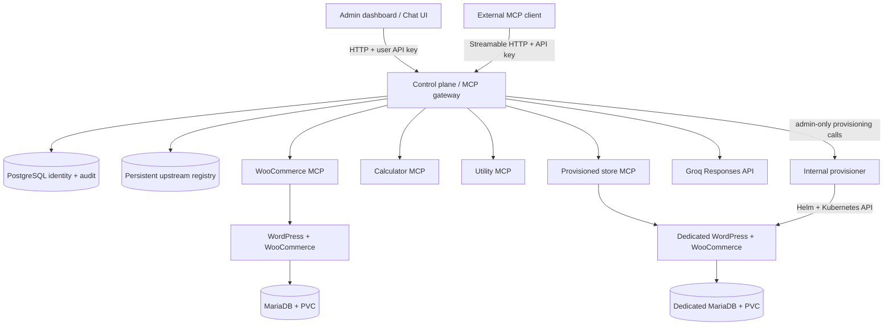

# Urumi — Team MCP Gateway

A Kubernetes-native MCP gateway for connecting tools from multiple upstream servers behind one authenticated endpoint. Urumi includes a WooCommerce operations server, Calculator and Utility MCP servers, an admin dashboard, an LLM-powered chat agent, persistent identity/API-key management, audit logging, and isolated on-demand WooCommerce store provisioning.

> **Project status:** the application builds locally, and the local Minikube environment has been used to verify gateway authentication/auditing, tool aggregation, upstream isolation, chat tool calling, and provisioning of a second store. Consult [`docs/demo-runbook.md`](docs/demo-runbook.md) for the remaining acceptance checks. A successful build is not a substitute for the full live demo.

## Features

- **MCP aggregation:** combines enabled upstream tools at one Streamable HTTP MCP endpoint and exposes collision-safe names such as `woocommerce__list_products`, `calculator__mean`, and `store-store-two__list_products`.
- **WooCommerce operations:** `list_products`, `create_product`, `list_orders`, `get_order`, and `update_order_status`.
- **Additional upstreams:** Calculator (`calculate`, `mean`) and Utility (`get_current_time`, `generate_uuid`).
- **Access control:** admin/member roles, generated user API keys, hashed key storage, key revocation, and protected admin endpoints.
- **Auditing:** persistent PostgreSQL events record the authenticated identity, upstream/tool, start/completion, duration, and outcome.
- **Chat agent:** calls an LLM Responses API, discovers tools through the gateway, executes them through the same authenticated MCP endpoint, and displays its tool calls.
- **Multi-store provisioning:** creates a dedicated namespace, per-store WordPress/MariaDB deployment, credentials, PVCs, ingress, network-policy baseline, quotas/LimitRange, and WooCommerce MCP upstream; deletion removes the store namespace and release.
- **Kubernetes deployment:** separate reusable Helm charts for the shared platform and each WooCommerce store.

## Architecture



### Request path

1. A caller connects to the gateway's MCP endpoint and authenticates with a user API key.
2. The gateway filters and aggregates tools from enabled upstreams. An upstream's tools use the `<upstream-id>__<tool-name>` prefix.
3. The gateway routes tool calls to the selected upstream with a timeout and upstream-failure isolation.
4. The gateway writes an audit record for the authenticated call.
5. The chat agent uses the same gateway and identity path; the LLM provider key stays in a Kubernetes Secret and is never sent to the browser.

## Repository layout

```text
apps/dashboard/                    Admin dashboard and chat pages
charts/platform/                   Gateway, PostgreSQL, MCP upstreams, provisioner
charts/store/                      Reusable isolated WooCommerce store chart
images/wordpress-woocommerce/      WordPress/WooCommerce image customization
services/control-plane/            MCP gateway, API, auth, audit, chat orchestration
services/woocommerce-mcp/          WooCommerce MCP tools and signed REST client
services/calculator-mcp/            Calculator MCP tools
services/utility-mcp/               Utility MCP tools
services/provisioner/              Store lifecycle service
packages/shared/                    Shared package space

docs/                               Architecture, operations, and demo instructions
```

## Prerequisites

For the local demonstration:

- Node.js 24 and npm.
- Docker Desktop using Linux containers.
- Minikube, `kubectl`, and Helm.
- An ingress controller (the walkthrough uses the Minikube `ingress` add-on).
- A Groq API key for the chat agent.

The platform chart uses `admissionregistration.k8s.io/v1` `ValidatingAdmissionPolicy` resources, so the cluster must support Kubernetes **1.30 or newer**. Check your Minikube/k3s version before installing the chart.

## Build and regression tests

From the repository root:

```powershell
npm ci
npm run build
npm test
npm run check
```

`npm run build` compiles each TypeScript workspace. `npm test` runs the focused Node.js regression tests. `npm run check` runs formatting checks, builds, and tests. Kubernetes acceptance tests are separate and must be run against a deployed cluster; see [`docs/demo-runbook.md`](docs/demo-runbook.md).

## Local Kubernetes deployment

The chart expects Kubernetes Secrets to be created **before** the relevant pods start. Never commit provider keys, admin tokens, database passwords, WooCommerce credentials, or generated per-store credentials.

### Required platform Secrets

Create these in the platform release namespace (the examples use `urumi-platform`):

| Secret                  | Required keys                                                       | Purpose                                                             |
| ----------------------- | ------------------------------------------------------------------- | ------------------------------------------------------------------- |
| `urumi-gateway-db`      | `postgres-db`, `postgres-user`, `postgres-password`, `database-url` | PostgreSQL credentials and connection string                        |
| `urumi-gateway-admin`   | `admin-token`                                                       | Bootstrap admin token and internal provisioner authentication token |
| `urumi-llm-credentials` | `api-key`                                                           | Groq API key for the chat agent                                     |

The connection string in `database-url` must target the platform PostgreSQL Service from inside the cluster. For a release named `urumi-platform` in namespace `urumi-platform`, its service is `urumi-platform-postgres`.

For each statically installed WooCommerce store, the chart also expects:

- `store-credentials`: `db-root-password`, `db-password`, `wordpress-admin-password`.
- `woocommerce-api-credentials`: `consumer-key`, `consumer-secret`.

Dynamically provisioned stores generate and install their own credentials. Prefer the dashboard/provisioner flow for creating an additional store.

### Build images for Minikube

The store MCP image default is `urumi/woocommerce-mcp:0.1.7`. The platform values also reference `urumi/control-plane`, `urumi/provisioner`, `urumi/calculator-mcp`, `urumi/utility-mcp`, and `urumi/wordpress-woocommerce`. Build and load the image versions named in your values before deploying, or change image tags to match the images you built:

```powershell
minikube start -p urumi-local
minikube addons enable ingress -p urumi-local
# Rebuild the provisioner with the updated store chart bundled into the image.
docker build -f services/provisioner/Dockerfile -t urumi/provisioner:0.1.2 .
# Load images into the Minikube node:
minikube image load urumi/control-plane:0.1.11 -p urumi-local
minikube image load urumi/provisioner:0.1.2 -p urumi-local
minikube image load urumi/calculator-mcp:0.1.0 -p urumi-local
minikube image load urumi/utility-mcp:0.1.0 -p urumi-local
minikube image load urumi/woocommerce-mcp:0.1.7 -p urumi-local
```

For an existing local platform, upgrade the platform release to activate the new provisioner image. Helm will reconcile the platform chart resources as part of this upgrade:

```powershell
helm upgrade urumi-platform .\charts\platform `
  --namespace urumi-platform --reuse-values `
  --set-string provisioner.image.tag=0.1.2 --wait --timeout 10m
kubectl rollout status deployment/urumi-platform-provisioner -n urumi-platform --timeout=180s
```

Build the WordPress image from `images/wordpress-woocommerce/Dockerfile` and load the exact tag configured under `charts/store/values.yaml` as well. The commands above assume those images have already been built locally.

### Install and access

Install the store and platform using the chart values appropriate for your environment. The platform chart is installed with a release named `urumi-platform` in namespace `urumi-platform`; a store chart release can be named `urumi-store` in namespace `urumi-store`. The platform gateway Service listens on port `4000` inside the cluster.

For local access, port-forward the gateway and the ingress controller in separate PowerShell terminals:

```powershell
kubectl port-forward -n urumi-platform svc/urumi-platform-gateway 4016:4000
kubectl port-forward -n ingress-nginx svc/ingress-nginx-controller 8080:80
```

Then open:

- Admin console: <http://127.0.0.1:4016/dashboard/>
- Chat agent: <http://127.0.0.1:4016/chat/>
- Original store: <http://shop.urumi.test:8080/>

Add local storefront hosts to the Windows hosts file at `C:\Windows\System32\drivers\etc\hosts`, pointing them at `127.0.0.1`. For a provisioned store with slug `store-two`, add `127.0.0.1 store-two.urumi.test`. Storefront site URLs use port `8080` in the Minikube example.

The commands above are orientation only; see [`docs/multi-store-provisioning.md`](docs/multi-store-provisioning.md) and the demo runbook for the required secrets, chart values, and complete flow. Do not use the demo tokens or local HTTP URLs for a public production deployment.

## Upstream authentication

Administrators can register a generic MCP upstream without authentication, with a bearer token, or with a custom header credential. Credential values are stored in a dedicated Kubernetes Secret by the internal provisioner; only non-secret authentication metadata is retained in the JSON registry and returned to the dashboard. See [`docs/upstream-credentials.md`](docs/upstream-credentials.md) for the credential flow, API shapes, and least-privilege controls.

## Store provisioning and deletion

Store creation/deletion is performed by the gateway admin API, which proxies requests to an internal ClusterIP-only provisioner. The provisioner uses a dedicated Kubernetes ServiceAccount and scoped RBAC to create namespaces, install the reusable store chart, wait for readiness, create WooCommerce API credentials, and tear down a store. A per-owner limit defaults to three active stores. Review [`docs/multi-store-provisioning.md`](docs/multi-store-provisioning.md) before using it outside a disposable development cluster.

## Security and operational limitations

- User API keys are returned at creation time and stored as hashes; revoke and rotate keys rather than reusing them indefinitely.
- Keep provider credentials and bootstrap/internal tokens in Kubernetes Secrets and out of source control, screenshots, and logs.
- The provisioner is designed for **one replica**; operation locks and a durable job queue are needed before horizontal scaling.
- Namespace deletion does not universally guarantee that an external persistent volume is securely erased; actual cleanup depends on the cluster's StorageClass reclaim policy.
- Local HTTP ingress, demo credentials, and the default `urumi.test` domain are development-only. Production requires HTTPS, DNS/TLS, a suitable StorageClass, hardened RBAC, backup/restore, and an explicit tenant authorization policy.

## Project documentation

- [Fresh local Minikube setup](docs/local-minikube.md)
- [Chat agent configuration](docs/chat-agent.md)
- [Multi-store provisioning](docs/multi-store-provisioning.md)
- [Security model and design trade-offs](docs/security-and-design.md)
- [Optional upstream credentials](docs/upstream-credentials.md)
- [Demo and acceptance runbook](docs/demo-runbook.md)
